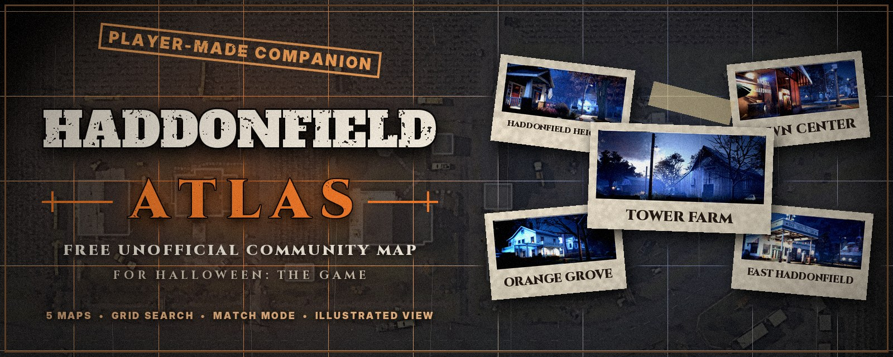
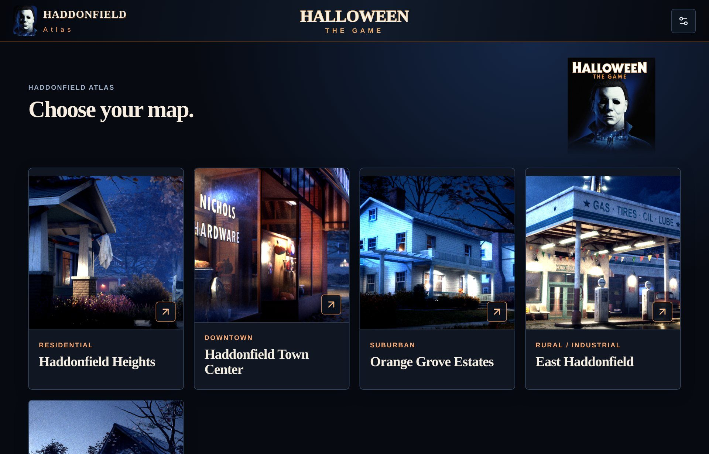
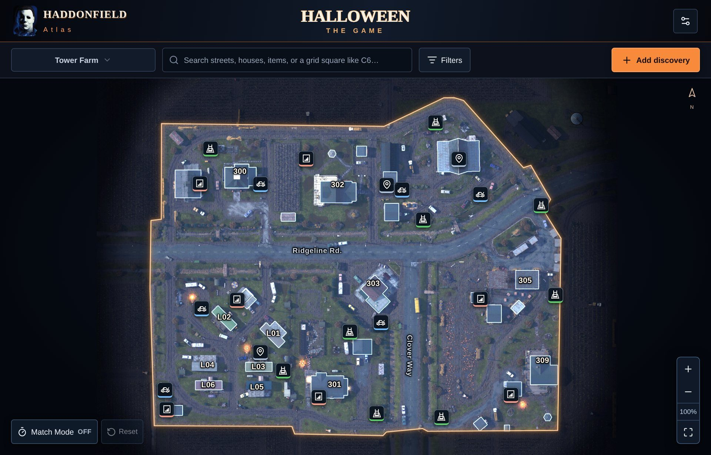
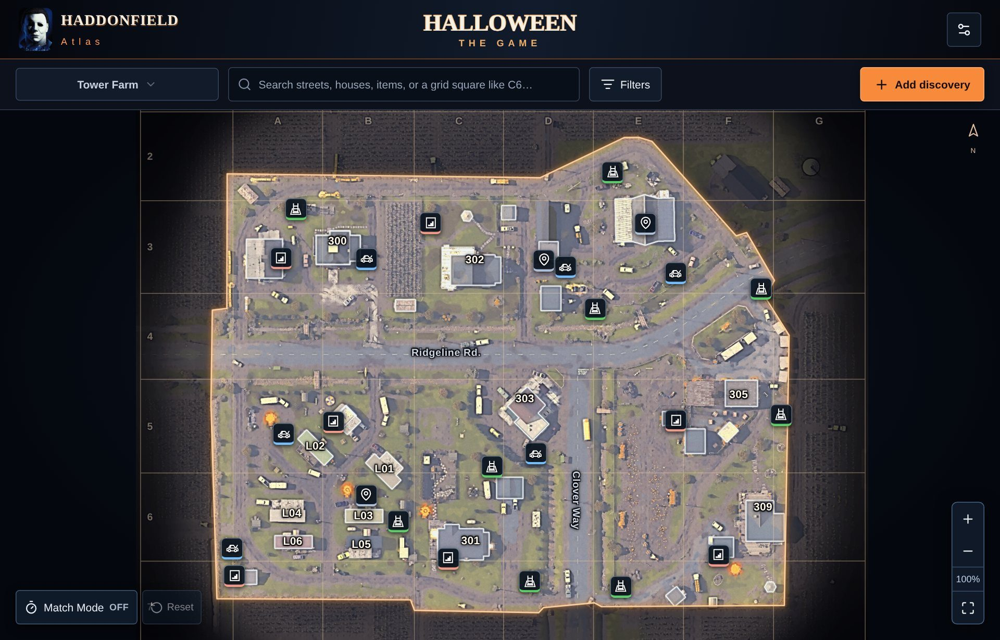
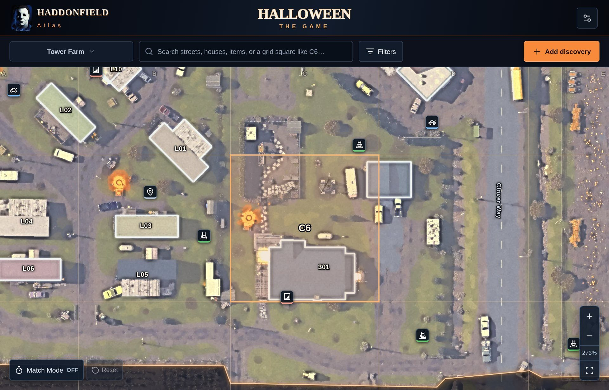
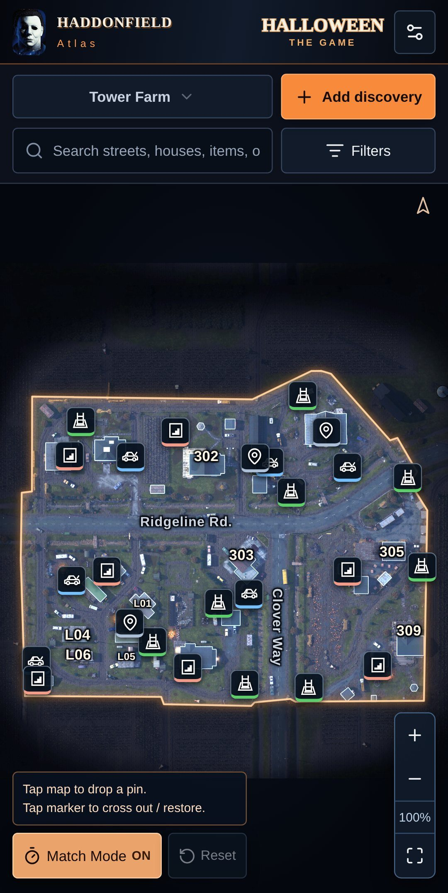

  

  <a href="https://gitjon72.github.io/Haddonfield-atlas/"><b>Open the Atlas</b></a> ·
  <a href="https://github.com/Gitjon72/Haddonfield-atlas/releases/latest">Latest release</a> ·
  <a href="https://github.com/Gitjon72/Haddonfield-atlas/issues">Report a problem or discovery</a> ·
  <a href="CHANGELOG.md">Changelog</a>

---

**Haddonfield Atlas** is a free, unofficial interactive mapping companion for **Halloween: The Game**. It's built to make map knowledge easy to find, organize, and use while you play.

**Live site:** https://gitjon72.github.io/Haddonfield-atlas/

No account and no install. Open the site, choose a map, and keep it next to the game.

  
  

## Maps

All five maps are included:

| Map | Area |
| --- | --- |
| Haddonfield Heights | Residential |
| Haddonfield Town Center | Downtown |
| Orange Grove Estates | Suburban |
| East Haddonfield | Rural / Industrial |
| **Tower Farm** | Farms / Trailer Park |

## Features

### Interactive maps
Pan and zoom through each map. Markers and building labels stay anchored to their locations at every zoom level. When space gets tight, labels shrink or hide instead of drifting away from their buildings.

### Escape locations
Possible storm cellars (hatches), sewers / storm drains, escape gates and civilian escape car spawns are shown as separate categories, each with its own filter. Spawns are randomized, so these are **possible** locations — check the current match.

### The real game grid
Turn on the optional **A–G / 1–8 grid**. It's traced from the in-game paper map, so the squares match what your teammates see in-game.

### Grid search
Type a square such as **C6** into the search box and press Enter. The map jumps to that square and highlights it.

  
  

### Illustrated view
Switch any map to an **Illustrated** style from the Filters panel. It's the same map with the same buildings, outlines, markers and grid, just easier to read in daylight. The original dark view stays the default.

### Search and filters
Search streets, houses, items and locations, and filter what's on the map so you only see what you need.

### Personal discoveries
Add your own discoveries. Personal markers can be named, categorized, positioned, edited, moved and given notes, so what you find is there next match.

### Match Mode
Built for the second or two you have during an active match. When Match Mode is on you can:

- Tap the map to drop a temporary match marker instantly.
- Add a name or note later if there's time.
- Tap any visible marker to cross it out for this match, and tap again to restore it.
- Turn a temporary marker into a permanent personal discovery.
- Reset the match to clear temporary pins and cross-outs.

Resetting Match Mode does **not** remove permanent discoveries, notes or settings.

  

### Works on your phone
The Atlas is mobile-friendly with large touch targets, so it works on a phone or tablet beside your screen.

### Saved locally, with backups
Your personal Atlas data is stored in your own browser. Nothing you add changes the public Atlas or shows up for anyone else. Use **Settings → Export backup / Import backup** to move your data to another device or keep a copy safe.

## Releases

Each version has its own release page with notes and artwork:

- [v1.1.0 — Tower Farm Update](docs/releases/v1.1.0.md)
- v1.0.0 — First release

See the [Changelog](CHANGELOG.md) for everything that changed.

## Map information and accuracy

Haddonfield Atlas combines researched map information with player discoveries. Not every marker is a guaranteed spawn; some locations are approximate or vary between matches. Tower Farm escape positions come from community game-file data and are being confirmed in live matches.

Game updates, randomized elements and incomplete evidence can all affect accuracy. If something's wrong or missing, report it so it can be reviewed before the master Atlas changes.

## Report a problem or discovery

Use **Issues**: https://github.com/Gitjon72/Haddonfield-atlas/issues

- **Bug Report** — something in the app isn't working.
- **Map Correction / Discovery** — incorrect, missing or newly discovered map information.
- **Feature Request** — an idea to improve the Atlas.

Screenshots, video, grid squares and repeatable observations are especially helpful for map reports.

## Credits

- Built and maintained by **Gitjon72**, with AI assistance for development, research organization and coding.
- Tower Farm escape-actor positions and map registration were cross-checked against the community project [p8riot/halloween-maps](https://github.com/p8riot/halloween-maps).

## Disclaimer

Haddonfield Atlas is an independent, unofficial, non-commercial community project. It is not affiliated with or endorsed by the developers, publishers or intellectual-property owners of **Halloween: The Game**. Game names, trademarks, artwork and other game-related intellectual property belong to their respective owners.
