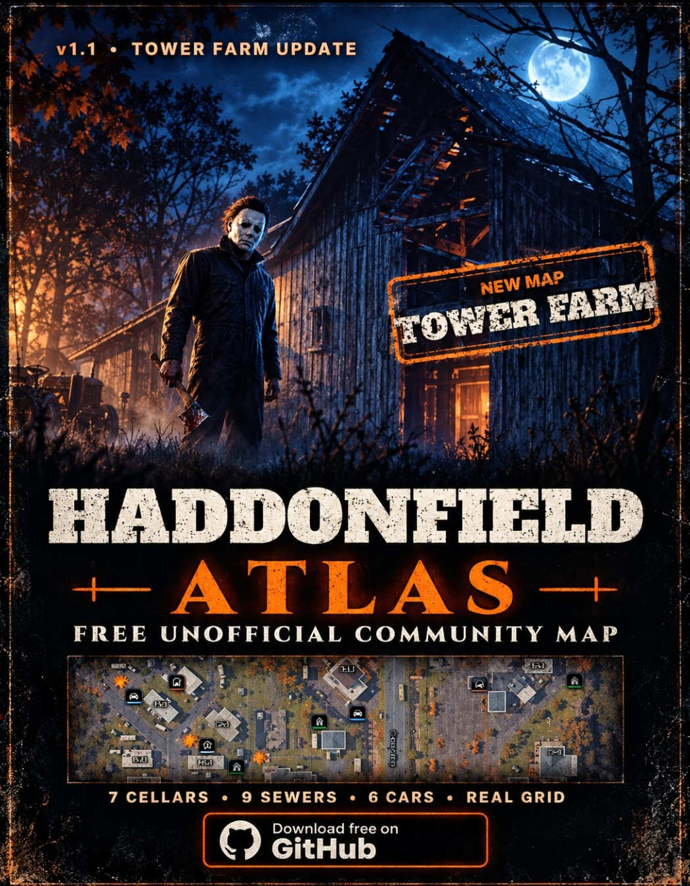

# Haddonfield Atlas v1.1.0 — Tower Farm Update

**Open the Atlas:** https://gitjon72.github.io/Haddonfield-atlas/

The fifth map is here. Tower Farm joins Haddonfield Heights, Town Center, Orange Grove Estates and East Haddonfield, and every map gets the real in-game grid.

## What's new
- **Tower Farm map** — farmhouses, trailer park, Ridgeline Rd. and Clover Way, with building and trailer numbers.
- **22 possible escape spots on Tower Farm** — 7 storm cellars, 9 sewers and 6 escape car spawns, each with its own filter.
- **The real game grid** — A–G and 1–8, traced from the in-game paper map on all five maps.
- **Grid search** — type `C6`, press Enter, and you're there.
- **Illustrated view** — a lighter, easier-to-read style for every map. Same spots, new look.
- **Labels that stay put** — zoom in and out and building labels stay on their buildings.
- **Green sewers** — sewers are now green so they never get mixed up with storm cellars.

## Upgrading
Nothing to do. Open the site and your saved discoveries, notes and settings are still there.

Full details are in the [Changelog](../../CHANGELOG.md).

*Spawns are randomized. Escape markers show possible locations, so check every match.*
